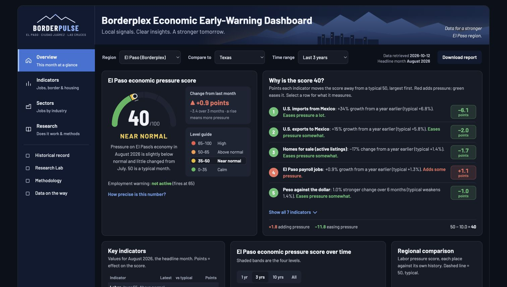

# BorderPulse

**An open early-warning laboratory for the El Paso–Juárez Borderplex economy.**

[](https://github.com/MarcusHunt090/borderpulse/actions/workflows/ci.yml) · [Technical note](technical_note.md) · [Reproduction guide](RUNBOOK.md) · [MIT license](LICENSE)

BorderPulse compresses seven public monthly indicators for the El Paso metro area into a 0–100 index of economic stress, back-tests it against targets that were fixed *before* any result was seen, and publishes every result — including the negative ones — with honest small-sample inference. Everything here reruns from raw CSVs with one command.

- **Dashboard:** [download the HTML snapshot](borderpulse_dashboard.html) and open it in a browser. The same page is in [`docs/index.html`](docs/index.html), ready for GitHub Pages.
- **Technical note:** [`technical_note.md`](technical_note.md) — generated from the pipeline's own JSON, so it cannot disagree with the dashboard
- **Current headline (model v6.1):** August 2026 · **40 / 100 · Near normal** · employment alert not active

> This is a transparent screening device for unusual local conditions — stronger at confirming stress than predicting it. It is not a forecast, not a probability, and not official statistics.



*Dashboard snapshot for August 2026. The [technical note](technical_note.md) explains the data, methods, and validation.*

## What the score is

| Layer | Weight | Indicators (FRED series) | Stress direction |
|---|---|---|---|
| Local labor | 40% | El Paso unemployment, 6-mo change (`ELPA348UR`); El Paso nonfarm payrolls, YoY (`ELPA348NAN`) | unemployment up, jobs down |
| Border economy | 35% | US imports from Mexico, YoY (`IMPMX`); US exports to Mexico, YoY (`EXPMX`); peso/USD, 6-mo move (`EXMXUS`) | trade down, peso weaker |
| Housing market | 25% | Active listings, YoY (`ACTLISCOU21340`); median days on market, YoY (`MEDDAYONMAR21340`) | listings up, days up |

Each indicator is z-scored against **its own history up to that month only** (expanding window from 2000, minimum 36 months, clipped to ±3), averaged within its layer, combined with the weights above, and mapped to 0–100 with a logistic squash so that 50 is a historically typical month. Levels: Calm < 35 ≤ Near normal < 50 ≤ Above normal < 65 ≤ **High** (the only operational alert).

The weights, thresholds and transforms are **documented conventions, not fitted parameters**, and the published sensitivity grid (90 alternative conventions) shows what moves when you change them.

## What the validation says (2003–2026, publication lags applied)

- The ≥ 65 alert fired in **two episodes** in 23 years — around the 2008–09 recession and COVID — and never during an expansion.
- Dated against when downturns actually began: **one advance warning** (October 2008, two months before payroll growth turned negative) and **one detection** once under way (April 2020). 19 of the 21 alert months already had negative payroll growth, so the index confirms stress more than it anticipates it.
- Month-level discrimination of payroll downturns: ROC-AUC 0.82 (block-bootstrap 95% CI 0.63–0.95, placebo p < 0.01). Discrimination of 0.5-point unemployment rises: AUC 0.47 — **chance** — and a plain local Sahm rule detects more of those events.
- The earlier claim that the peso *leads* El Paso jobs by seven months does not survive HAC inference with a 13-lead family (family-wise p ≈ 0.27) and was withdrawn.
- A pre-registered test of replacing national trade with port-of-entry crossings in the border layer (`border_test.py`) found no variant that beats the published layer with an interval above zero on both targets, so the composite was left unchanged.

Full tables, intervals and caveats: `technical_note.md` §5, and the Research tab of the dashboard.

## Reproduce it

```bash
git clone https://github.com/MarcusHunt090/borderpulse.git
cd borderpulse
python3 -m venv .venv
source .venv/bin/activate
python -m pip install -r requirements.txt
python refresh.py --no-fetch       # rerun everything on the committed data
```

`refresh.py --no-fetch` runs the whole chain in order:

```
pipeline.py        → borderpulse_output.json      current score, layers, drivers, nowcast
backtest.py        → validation/backtest_*        leakage-free back-test with publication lags
test_backtest.py                                  12 checks (targets, no look-ahead, lags) — must all PASS
benchmarks.py      → validation/benchmarks.json   episode-first metrics, local Sahm rule, Dallas Fed BCI (if present)
leadlag.py         → validation/leadlag.json      border indicators vs El Paso jobs, leads 0–12
horizons.py        → validation/horizons.json     3 / 6 / 12-month targets, band probabilities
inference.py       → validation/inference.json    block bootstrap, placebo, Newey–West, calibration, robustness grid
border_test.py     → validation/border_test.json  pre-registered trade-vs-crossings comparison
onset_eval.py      → validation/onset_eval.json   warning-before-onset vs detection-after-onset
vintage_audit.py   → validation/vintage_audit.json real-time (ALFRED) audit — "pending" until vintages are exported
test_vintage_audit.py                             6 checks on the audit framework — must all PASS
make_manifest.py   → data/MANIFEST.json           SHA-256, span, source and retrieval date for every data file
make_technote.py   → technical_note.{md,html}     the write-up, every number read from the JSON above
build.py           → artifact.html, borderpulse_dashboard.html, docs/index.html
make_brief.py      → borderpulse_brief.md         the one-page monthly brief
```

Random seeds are fixed (42). Open `borderpulse_dashboard.html` in a browser to see the result.

To pull fresh data, run `python3 refresh.py` on a machine with internet access (FRED and BTS downloads; the Dallas Fed benchmark additionally needs `pandas` + `openpyxl`). `RUNBOOK.md` has the full refresh procedure, including how it is done from inside a Claude session where direct downloads are blocked.

## Repository layout

```
pipeline.py, backtest.py, …   the chain above (plain Python; numpy / scipy / scikit-learn only)
dashboard_body.html           the dashboard page with /*__X__*/ placeholders that build.py fills
data/                         inputs. 2015→ files refreshed monthly; pre2015/ static history;
                              full/ = merged 2000→present for the five composite inputs;
                              extra/ = watch series (BTS crossings etc.) that never enter the score;
                              MANIFEST.json = hash of every file
validation/                   every back-test and inference output (JSON/CSV)
docs/index.html               built dashboard, for GitHub Pages
docs/partner_data_request.md  template letter for community data partners
tools/                        helpers to recover data and the page from a published dashboard
technical_note.md             generated write-up · borderpulse_brief.md  generated monthly brief
CHANGELOG.md · CITATION.cff · CONTRIBUTING.md · RUNBOOK.md · LICENSE
```

## Data

All inputs are public series with a FRED or BTS identifier; `data/MANIFEST.json` lists the source, span, retrieval date and SHA-256 of each of the 34 files. Data are the latest available (revised) vintage at retrieval — the single largest open limitation, which `vintage_audit.py` is built to close once ALFRED vintages are exported (`python3 vintage_audit.py --fetch` with a `FRED_API_KEY`).

Border crossings combine the El Paso (2402) and Ysleta (2401) ports, because CBP made Ysleta a separate port on 2020-03-16 — a data fact earlier versions misread as a reporting break.

## Known limitations

Six deterioration events since 2003, two of them COVID-driven, so every rate carries a wide interval. Revised rather than real-time data. The housing layer only exists from mid-2019 (earlier composites are two-layer). Payroll series are not seasonally adjusted, hence 12-month changes. Overlapping windows in all 6- and 12-month transforms (addressed by HAC and block methods, not eliminated). Crossings cover two ports only; the planned Bridge of the Americas rebuild will move commercial trucks between ports.

## Citing

See `CITATION.cff`. Code is MIT-licensed; data are redistributed under each source's terms.

## Contributing

Read `CONTRIBUTING.md` first — in short: reproduce before changing, pre-register analyses, nothing enters the score without a documented back-test improvement and a version bump.

---

Maintained by Marcus Hunt, El Paso, TX · marcusjhunt01@gmail.com
